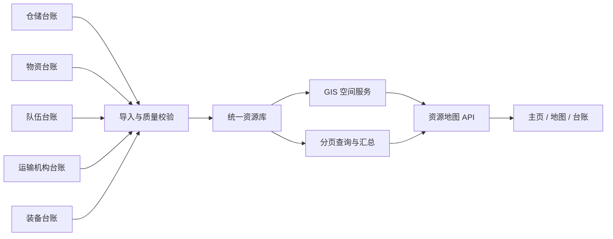

# 应急保障资源一张网 · 主页产品与架构设计

## 1. 产品定位

面向绵阳市应急保障人员，将仓储网点、物资明细、应急队伍数量统计、交通运输机构和应急装备放在同一张可下钻地图上。页面只呈现最新来源数据实际提供的属性，并保留仓库与其所属物资之间的来源关联。

资源之间只有在来源数据明确给出关联时才建立关系。当前可确认的是物资明细的“所属仓库”字段；没有展示运输机构到车辆、救援队伍到具体装备等未提供的关联，也不绘制臆造的调度线路、到达时效或覆盖范围。

## 2. 首页信息架构

| 位置 | 信息 | 展示口径 |
| --- | --- | --- |
| 顶部 | 区县筛选、关键词搜索、资源台账 | 全页共用筛选；资源台账唯一入口位于搜索框右侧 |
| 核心指标 | 仓储网点、物资明细、应急队伍数量、运输机构、装备记录 | 按当前区域和关键词统计；不显示缺少来源支撑的状态或能力值 |
| 左侧上方 | 仓库级别统计、仓储点名称 | 按来源仓库级别分组，空值保留为“级别未填” |
| 左侧下方 | 物资来源品类和明细记录数 | 显示记录数占比，不将不同计量单位相加，也不把记录数当库存量 |
| 中央地图 | 行政区边界、单选资源图层、仓网点位和上下级连线 | 仓点按级别和缩放分层显示；队伍数量按区县着色，不绘制虚构的单支队伍点位 |
| 地图下方 | 九个区县资源计数 | 仓、队、站、装备按来源统计，点击进入区县 |
| 右侧 | 运输机构、应急队伍数量统计、应急装备 | 运输机构展示最新表中的站场属性；队伍仅按区域显示数量；装备数量按原单位分开展示 |
| 资源台账 | 仓储、物资、运输机构、救援队伍、装备分类 | 顶部唯一入口；表格分页、区域/关键词筛选、CSV 导出 |

侧栏资源行和地图标记打开详情，不进入资源台账。物资品类行只应用关键词筛选。仓库详情根据来源“所属仓库”精确关联物资明细。

## 3. 数据来源与清理

页面数据由用户提供的五类业务数据整理生成；交通机构和应急队伍均已由本次更新文件替换：

- 应急物资储备库信息
- 应急物资信息
- 绵阳市应急队伍数量统计表
- 交通运输机构信息_合并
- 绵阳市应急装备有效数据

原始数据量及页面处理：

| 类别 | 来源记录 | 页面记录 | 说明 |
| --- | ---: | ---: | --- |
| 仓储网点 | 1,845 | 1,844 | 排除名称和地址均为测试数据的一条记录；其余点位有坐标 |
| 物资明细 | 35,517 | 35,517 | 全部按所属仓库名称匹配成功；保留来源品类、规格、数量和计量单位 |
| 应急队伍 | 1,441 支系统合计 | 15 个区域汇总行 | 只保留区域名称和队伍数量；不沿用旧表的单支队伍名称、人数、主管单位、驻地和能力 |
| 交通运输机构 | 117 | 117 | 使用合并表中的名称、行政区划、站场类型、运输方式、吞吐能力、面积、负责人、联系电话、坐标和用途；空字段不补填 |
| 应急装备 | 280 | 280 | 保留设备类型、使用单位、地址、坐标、数量和单位 |

队伍统计文件没有单支队伍的名称、驻地、能力或人员属性，因此这些旧字段已从页面移除。交通运输机构只展示最新合并表中有值的负责人和联系电话。仓储来源中有 10 个点位无法确认到九个区县，仍保留原坐标并归入“未归属区县”；不会从名称猜测到具体区县。

## 4. 地图与交互

1. 地图默认只显示仓储网点，运输站场、队伍统计和应急装备为互斥单选图层。资源点使用轻量符号，不再显示数字聚合圆点；按地图缩放逐步显示市县、乡镇、村级仓点，并在放大查看时控制点位密度。队伍统计图层按区县数量分级着色，点击区县进入下钻。
2. 仓网连线依据来源仓库级别建立：市级仓连接县级仓，县级仓连接同区县乡镇级仓，乡镇级仓连接可由名称/管理单位明确匹配的村级仓；同一层级有多个上级仓时按地理距离选择最近县级仓。无法可靠匹配的村级仓不绘制推测连线。
3. 点击区县边界或地图下方区县项进入区县范围。顶部区县筛选、侧栏统计、地图标记和资源台账同步更新。
4. 仓库详情展示仓库基础属性和关联物资明细；运输站场详情使用最新合并表字段；队伍详情只呈现区域名称和数量；装备详情使用装备来源字段。
5. 地图图层通过单选切换，始终只显示一种资源；支持放大、缩小、回到全域及底图切换。
6. 资源台账用唯一顶部入口打开，可按类别切换、分页、搜索和导出；再次点击入口、返回地图或按 Escape 可关闭。
7. 搜索支持名称、行政区划、地址、分类、物资名称及规格；按 `/` 聚焦搜索。

## 5. 统计口径与边界

- 仓储网点：1,844 条；级别按来源字段汇总。页面不推断仓点可用状态或仓储能力等级。
- 物资明细：35,517 条；按来源单位展示。分类列表的数字是明细记录条数，不是同一单位的实物库存总量。
- 应急队伍：系统合计 1,441 支；区域汇总为 1,440 支，差额 1 支未落到具体区域。科学城数量为空，按未提供展示，不推断为零。队伍统计表不提供单支队伍属性，旧表字段不再展示。
- 交通运输机构：117 条记录，均有坐标。合并表只有少数记录提供吞吐能力、面积或联系方式；空值不补填，车辆数和可调运力不推算。
- 应急装备：280 条记录；个数、台、部、套等单位分别展示，不做跨单位合计。
- 坐标：地图使用原表经纬度；区县优先采用行政区划字段，缺少县级名称时再按坐标与边界核对。无法确认区县的点位保留为未归属。
- 页面以最新来源表形成静态数据快照。刷新只重新渲染当前页面数据，不代表与业务系统实时同步。

## 6. 后续生产架构建议

正式系统可由资源主数据、GIS 空间服务、汇总读模型和台账 API 组成。导入链路应记录来源文件、导入批次、字段映射、坐标质量、区县归属置信度、重复记录和关联失败记录；校验通过后再发布首页统计。

- 存储建议使用 PostgreSQL/PostGIS 保存资源、行政区和空间索引；库存明细应保留来源单位、规格和来源仓库键。
- 地图优先采用视窗查询、空间聚合或矢量切片；台账用服务端筛选和分页，避免浏览器加载全量物资。
- 每次导入返回批次时间和质量报告；实时同步状态只有在接入成功采集时间后才展示。
- 联系方式采用按岗位/权限控制的服务端字段，不放入公开静态资源文件；导出操作记录人员、范围和批次。

## 7. 本次交付

- 独立目录中的静态主页：`dist/index.html`；本目录之外的物流仿真演示未修改。
- 当前页面数据文件：`dist/data.js`；仅包含页面所需业务字段，不包含个人联系方式。
- 项目保留本地绵阳市行政区边界和 143 张概览卫星瓦片，支持无外网时查看概览底图。
- 本地运行：`node server.cjs`，然后访问 `http://127.0.0.1:4188/`；也可在浏览器中打开 `dist/index.html`。
